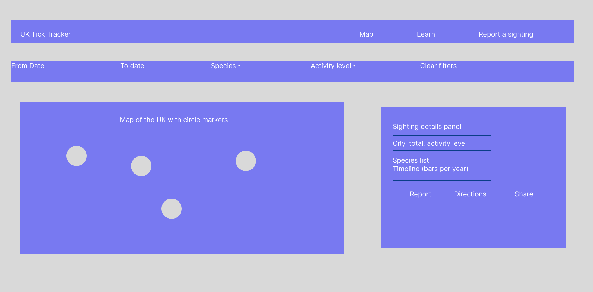
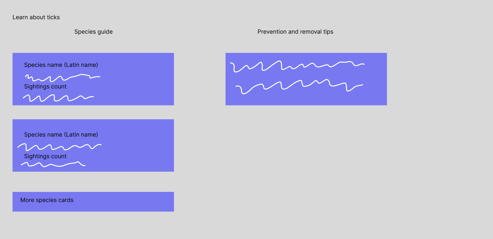
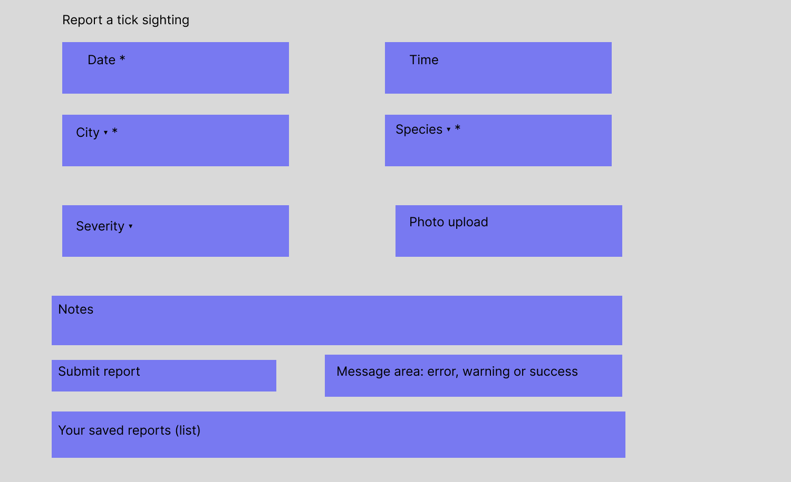

# UK Tick Tracker

Task: Elanco Placement Programme technical task (Frontend)
By Fajar Hussain

- Video walkthrough: https://youtu.be/NG8-dI5V-lA
  
- Live website link: https://fajarhussain.github.io/tick_tracker/

A web app that maps tick sightings across the UK, helps people learn about ticks and lets them report their own sightings. It is built with plain HTML, CSS and JavaScript and uses the Elanco Tick Sightings API.

## Wireframes

A sketch of the page layout, drawn in Figma after building the first version to document the design.

 

## Requirements covered

1. Interactive map visualisation
- Dynamic UK map showing sightings by city
- Circle markers: colour shows activity level (High, Medium, Low) and size shows number of sightings
- Filters: date range, species type and activity level

2. Sighting information
- Sidebar with species breakdown for the selected city
- Timeline showing sightings per year
- Quick actions: Report a sighting here, Get directions (Google Maps) and Share

3. Education content
- Species guide built from the API data (common name, Latin name, short description, sighting count and top cities)
- Prevention and removal tips

4. Report a sighting
- Form with date, time, city, species, number of ticks and notes
- Validation with clear error, warning and success messages
- Optional photo upload (images under 500 KB)

Extras
- Use of the API's /health and /stats endpoints to check the service and compare record counts
- Accessibility: labelled form fields, visible keyboard focus and status messages announced to screen readers

## Technical choices (why I chose to use these)

- HTML, CSS and JavaScript (no framework): quick to set up, no build step, and easy for anyone to run. I'm learning to use these in my modules right now, so I'm most familiar with them. I have experience with Java and a little background knowledge of HTML. Since I chose the frontend task, I knew CSS would be the best way for me to make it all visually appealing, and HTML goes hand in hand with CSS.
- Leaflet is a JavaScript mapping library, which seemed to be the easiest way for me to implement a map from the options Claude gave me of libraries.

## How to run

1. Download or clone this repository.
2. Open the folder in Visual Studio Code.
3. Install the "Live Server" extension.
4. Right-click index.html and click 'Go Live'.
5. The page opens in your browser. An internet connection is needed for the map and the data.

## How the data is handled

- Data comes from https://dev-task.elancoapps.com/data/tick-sightings
- The API only gives city names, so I created a lookup table that converts each city to map coordinates.
- Cleaning: records with missing fields, invalid dates or duplicate ids are removed, and city names are tidied (for example "london" becomes "London").
- The /stats endpoint reports the expected number of sightings, so the footer shows how many were received and how many were removed during cleaning.
- The /health endpoint is checked before loading. If the service looks unavailable, a message is shown and the page still tries to load.
- If the API fails, the page shows a message and still works with the user's saved reports.

## Assumptions and limitations

- The API has no severity field, so the marker colour shows activity level (based on the number of sightings in each city) instead.
- Only cities in my lookup table appear on the map.
- Reports are saved in the browser only, so they are not shared between users or devices.
- The species guide uses the common and Latin names exactly as given by the API.
- Photos are limited to 500 KB because of browser storage limits.

## What I would improve with more time

- Save reports in a real database so everyone can see them.
- Add a seasonal activity chart with city and year dropdowns to see when ticks are most seen throughout the year.
- Add more cities and a breakdown of which ticks are more likely in which areas and near which animals.
- Add a feedback page.
- Make it more mobile friendly, as it doesn't show up well on phones.

## AI use

I used Claude and Gemini to help plan the project, draft parts of the code and explain how the API and Leaflet work. Claude suggested mapping libraries and I chose Leaflet from its options. The first examples I was given were too advanced, so I asked for explanations and then rewrote the code myself in simpler JavaScript so that I understand each part. I tested the
code myself.
